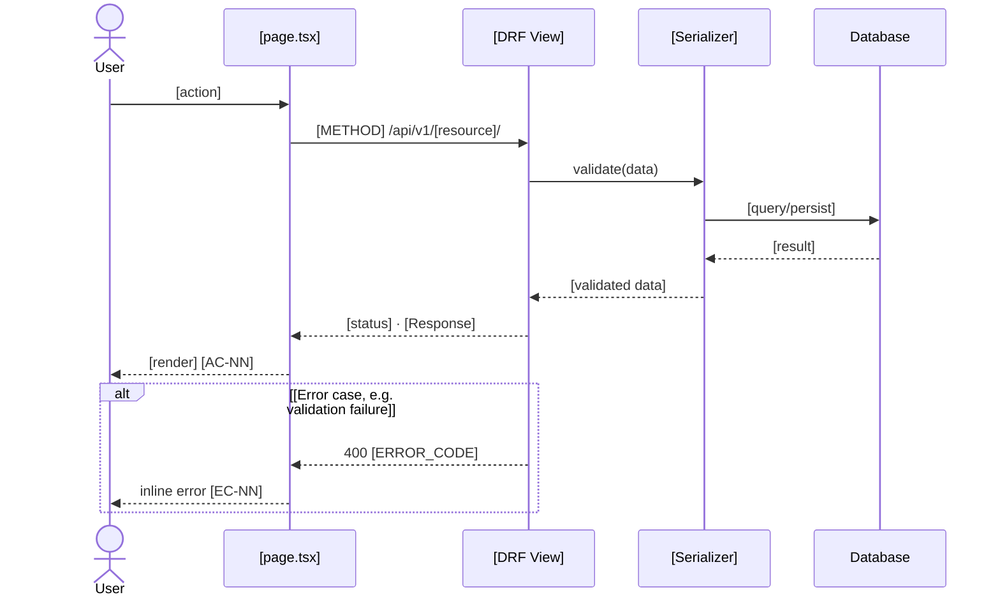

# Plan: [Feature Name] ([CODE])

> **Feature:** 7.x [Feature Name]
> **Spec:** [spec.md](spec.md)
> **SDS §5.x:** [SDS.md §5.x](../../SDS.md#5x-feature-name-code)

**Note**: This file is generated and extended by the `/speckit-plan` command — one `## [CODE]-US-NN` section
per user story, appended in the order stories are designed. When `plan.md` already exists for this feature,
**append** the new US section below the existing ones — never delete, rewrite, or renumber a previously
completed US section.

**No sibling design files.** Unlike a generic spec-kit scaffold, this project does not generate `research.md`,
`data-model.md`, `contracts/`, or `quickstart.md` as separate files. Those four concerns are folded directly
into each `## [CODE]-US-NN` section below — see **Decisions & Rationale**, **Domain Objects**, **API Contracts**,
and **Quickstart Validation**. This keeps one feature's whole design (why, what, and how to verify it) in one
file instead of scattered across five. (A small number of features designed before this convention — e.g.
`001-system-security` — still carry standalone `research.md`/`data-model.md`/`contracts/`/`quickstart.md` files
alongside their `plan.md`; those are left as historical record, not retrofitted.)

---

## [CODE]-US-NN: [Story Title]

### Pre-flight: Spec Review Findings

Reviewed `spec.md` and existing implementation before design. The following gaps and ambiguities were identified.

| ID | Type | AC | Finding | Resolution |
|----|------|----|---------|------------|
| G1 | **Gap** | AC-NN | [description of gap] | [how it's resolved — a decision below, or "Open task T1 — what to do"] |
| A1 | Ambiguity | AC-NN | [ambiguity description] | [resolution decision, with the reasoning if not obvious] |

> Repeat this section per user story if the feature's stories were reviewed separately. Every AC-referencing gap or ambiguity found during design belongs here — do not resolve it silently in the Architecture section below. If no gaps or ambiguities were found, state that explicitly rather than deleting the section.

*Pre-flight Gaps checklist*
- [ ] Zero spec gaps flagged — or flagged gaps were resolved before this `plan.md` was reviewed
- [ ] If significant gaps or ambiguity remain after review, the work goes back to the Spec step rather than being patched forward here
- [ ] Design scope matches the US being designed — no scope creep into unrelated stories

---

### Decisions & Rationale

*(Folds what a generic spec-kit scaffold would put in a separate `research.md` — Phase 0 output.)*

One entry per technical decision this story required (framework/library choice, whether a new service module is
needed per AR-01, how an edge case is enforced, etc.). Skip this section only if the story introduces literally
no new decision beyond "follow the existing pattern."

- **Decision**: [what was chosen]
- **Rationale**: [why chosen — tie back to constitution.md principles or an SRS/SDS constraint where relevant]
- **Alternatives considered**: [what else was evaluated, and why it was rejected]

---

### Domain Objects

*(Folds what a generic spec-kit scaffold would put in a separate `data-model.md` — Phase 1 output.)*

| Domain Entity (SRS §2) | Model / Table | Key Fields | Notes |
|--------|-------|------------|-------|
| `[Entity]` | `[app].[Model]` / `[table_name]` | `id`, [field1, field2] | [uniqueness, nullability, validation, or lifecycle notes worth calling out; state explicitly if no schema change is needed] |

*Data Modeling checklist*
- [ ] Entity/field names match SRS §2 domain language verbatim (NC-01) — no synonyms
- [ ] If a new Domain Entity is introduced: SDS §2.1 Domain Layer Traceability table is updated in the same PR
- [ ] Primary keys, enum casing, and any other divergence from SDS §2.2/§4.3.3 follow the project's documented "Known open drift" — don't introduce a new inconsistency (e.g. don't add a `uuid` PK to one new app while the rest stay integer-keyed)
- [ ] New indexed query pattern → note where `db_index=True` or a `Meta.indexes` entry is needed (PF-01)

---

### API Contracts

*(Folds what a generic spec-kit scaffold would put in a separate `contracts/*.md` — Phase 1 output. Skip this
section entirely if the story adds no new/changed endpoint.)*

**`[METHOD] /api/v1/[resource]/`**

| Field | Type | Notes |
|---|---|---|
| [request field] | [type] | [required/optional, validation rule] |

| Status | Body | Maps to |
|---|---|---|
| 200/201 | [response shape] | AC-NN |
| 4xx | `{"detail": "...", "code": "..."}` per API-03, or DRF's default `{field: [messages]}` | AC-NN / EC-NN |

*API Design checklist*
- [ ] Endpoint is versioned under `/api/v1/`, plural lowercase (kebab-case if multi-word) resource name (API-01, NC-02)
- [ ] Response shape follows API-02 — no custom envelope; list endpoints use DRF `PageNumberPagination`
- [ ] Status codes follow the API-04 mapping table
- [ ] A state transition uses its own explicit action endpoint (API-05) — never a generic `PATCH` for a lifecycle change
- [ ] A semantic business-rule error already catalogued in SDS §6.6 raises the matching `APIException` subclass (API-03); a new code is added to SDS §6.6 in the same PR, not invented ad hoc
- [ ] Serializer `fields` list is explicit and matches the SDS §6.2 DTO Registry (AR-04, PF-02) — no `password` or other sensitive field ever exposed (AC-04)

---

### Sequence Diagram — [Action Name]

Use a Mermaid `sequenceDiagram` (matches the convention already used in `SDS.md`). Show the happy path first, then one `alt` block per error/edge case, each tagged with the AC/EC it satisfies.

*Sequence Diagrams checklist*
- [ ] Arrows follow correct logical order; every action arrow has a matching return arrow
- [ ] Arrow labels describe the action/intent, not a method name or UI click target
- [ ] Each `alt` block is tagged with the AC/EC it demonstrates
- [ ] No direct SQL/ORM calls or method signatures appear on the diagram — only actor-level actions (View/Serializer/Service granularity at most)



---

### Business Rules Enforced

| Code | Rule | Source | Enforcement |
|------|------|--------|-------------|
| BR-NN | [rule description] | SRS §2.4 BR-NN / AC-NN | [Serializer/Service method] → [HTTP code] |

*Naming & Layered Architecture checklist* (self-check against constitution.md's Layered Architecture, AR-01..05)
- [ ] Straightforward ownership-scoped CRUD stays in the View + Serializer — no service module added speculatively (AR-01, Simplicity)
- [ ] If this story spans more than one model, has a business rule beyond field validation, or has side effects (e.g. writes a Notification): logic moves into a plain module-level `[app]/services.py` function, not inline in the View or `Serializer.create()`
- [ ] Views stay thin — HTTP binding, permission checks, ownership-scoped `get_queryset()` only (AR-02)
- [ ] No hand-written Repository class wrapping the Django ORM (AR-03)
- [ ] Multi-model writes are wrapped in `transaction.atomic()` (AR-05)
- [ ] Every list/detail/update/delete View filters its queryset by the authenticated User (AC-03)

---

### Element IDs

| Element | ID | Status | File |
|---------|----|--------|------|
| [button/input/message] | `[entity-field]` / `btn-submit-[entity]` per NC-04 | Done / **Missing** | `[component.tsx:line]` |

---

### Quickstart Validation

*(Folds what a generic spec-kit scaffold would put in a separate `quickstart.md` — Phase 1 output.)* One runnable
check per AC/EC — `curl` for API-only cases, a short browser-step list for UI cases. Do not include full
implementation code or migrations here; that belongs in `tasks.md` and the implementation itself.

- **AC-NN**: `curl -X [METHOD] http://localhost:8000/api/v1/[resource]/ -H "Authorization: Bearer <token>" -d '{...}'` → expect [status/body]
- **EC-NN**: [browser step] → expect [observable UI behavior]

---

### Open tasks

Number tasks `T1, T2, ...` in implementation order (model/migration → serializer → view/service → URL wiring → frontend). Use a lettered suffix (`T4b`, `T4c`) to insert a task discovered mid-planning without renumbering everything after it. Each row must name the concrete file(s) touched — a task without a file path is not planning-complete.

| ID | Task | File |
|----|------|------|
| T1 | [what to implement, including key delegations/collaborators] | `backend/[app]/[file].py` |
| T2 | [what to implement] | `frontend/src/app/[route]/page.tsx` |

---

<!--
  Repeat the "## [CODE]-US-NN: [Story Title]" block above for each additional user story
  designed in this feature. Do not merge stories into one section, and do not delete a
  prior US section when adding a new one.
-->

## Technical Context

**Language/Version**: Python 3.12 (Django 6.0.7) for backend; TypeScript 5 (Next.js 16.2.10, React 19.2.4) for frontend

**Primary Dependencies**: [DRF / SimpleJWT / other already-approved constitution.md stack pieces this story uses; call out explicitly if none are new]

**Storage**: SQLite (MVP) — [note whether a migration is required]

**Testing**: `python manage.py test` (DRF `APITestCase`, real throwaway test DB per Integration Testing Over Mocking); Playwright e2e under `tests/[feature-id]-[slug]/` for UI-facing behavior, if applicable

**Target Platform**: Single-machine home-LAN deployment (RUNBOOK.md) — backend :8000, frontend :3000

**Constraints**: [any fixed value this story must not change, e.g. JWT token lifetimes]

**Scale/Scope**: [per SRS §1.4/§4 — do not invent a stricter number than SRS states]

## Constitution Check

*GATE: Must pass before Decisions & Rationale. Re-check after Domain Objects/API Contracts design.*

| Principle | Status | Notes |
|---|---|---|
| [relevant AR-0x / API-0x / NC-0x / VL-0x / DOD-0x] | PASS / OPEN | [why] |

No unjustified violations — Complexity Tracking table below is empty unless one is documented.

## Project Structure

```text
backend/[app]/
├── models.py       # [new/modify — what]
├── serializers.py  # [new/modify — what]
├── views.py        # [new/modify — what]
├── urls.py         # [new/modify — what]
└── tests.py        # [new/modify — what]

frontend/src/app/[route]/
└── page.tsx        # [new/modify — what]
```

**Structure Decision**: [one line — does this story need a new Django app (per constitution's Package-by-Feature Structure), or does it extend an existing one?]

## Complexity Tracking

> Fill ONLY if a US design above required a Constitution Check violation (see constitution.md
> § "Simplicity Over Premature Scale"). One row per violation. Append new rows as later US
> sections introduce them — never delete a row belonging to a previously completed US.

| Violation | US | Why Needed | Simpler Alternative Rejected Because |
|-----------|----|-----------|-----------------------------------|
| [e.g., a new service module for straightforward CRUD] | [CODE]-US-NN | [current need] | [why the simpler alternative was insufficient] |
</content>
