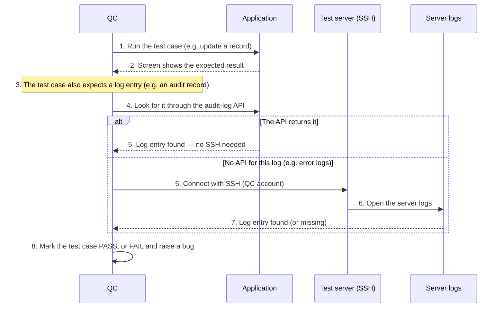

# Project Onboarding Guide

## Table of Contents

- [1 Overview](#1-overview)
  - [1.1 Purpose](#11-purpose)
  - [1.2 The Idea in One Minute](#12-the-idea-in-one-minute)
  - [1.3 Works for Any Project](#13-works-for-any-project)
  - [1.4 Definitions and Abbreviations/Acronyms](#14-definitions-and-abbreviationsacronyms)
- [2 Same Process, Different Projects](#2-same-process-different-projects)
  - [2.1 What Never Changes](#21-what-never-changes)
  - [2.2 What Each Project Sets Up](#22-what-each-project-sets-up)
- [3 Your First Day](#3-your-first-day)
  - [3.1 Checklist](#31-checklist)
  - [3.2 Tools by Role](#32-tools-by-role)
  - [3.3 What to Read](#33-what-to-read)
- [4 How a User Story Moves](#4-how-a-user-story-moves)
  - [4.1 The 6 Steps on One Page](#41-the-6-steps-on-one-page)
  - [4.2 What Happens Each Time You Run a Step](#42-what-happens-each-time-you-run-a-step)
- [5 Step by Step](#5-step-by-step)
  - [5.1 Step 1 — Spec](#51-step-1--spec)
  - [5.2 Step 2 — Design](#52-step-2--design)
  - [5.3 Step 3 — Quality](#53-step-3--quality)
  - [5.4 Step 4 — Implementation](#54-step-4--implementation)
  - [5.5 Step 5 — Deployment](#55-step-5--deployment)
  - [5.6 Step 6 — Verification](#56-step-6--verification)
  - [5.7 When QC Connects to the Test Server](#57-when-qc-connects-to-the-test-server)
  - [5.8 Check Progress](#58-check-progress)
- [6 Your Role at a Glance](#6-your-role-at-a-glance)
  - [6.1 Other Skills You May Use](#61-other-skills-you-may-use)
  - [6.2 Starting a New Story or Feature](#62-starting-a-new-story-or-feature)
- [7 Simple Rules](#7-simple-rules)
- [8 Using the Skills in Another Project](#8-using-the-skills-in-another-project)
- [9 Troubleshooting](#9-troubleshooting)
- [10 References](#10-references)
- [11 Appendix](#11-appendix)
  - [11.1 Command Cheat Sheet](#111-command-cheat-sheet)

## 1 Overview

### 1.1 Purpose

This guide helps you start working on a project that uses the **SDLC skills**. After reading it you will know how to set up your machine, which command to type at each step, and what you should check.

You do not need to know the whole process by heart. Claude does most of the work — **you give the input and review the result.**

### 1.2 The Idea in One Minute

Every piece of work is a **User Story** — one small feature, such as "a manager can approve a request". A User Story always goes through the same **6 steps**:

| # | Step | Who | In short |
|---|---|---|---|
| 1 | Spec | BA | Write down what the story must do |
| 2 | Design | SE | Decide how to build it |
| 3 | Quality | QC | Write the test cases and automated tests |
| 4 | Implementation | SE | Write the code |
| 5 | Deployment | SE | Put it on the test server |
| 6 | Verification | QC | Test it and report the result |

For each step you type **one command** in Claude Code, for example `/sdlc-design XX-US-NN`. Claude then:

1. creates a Jira ticket for the step and a git branch,
2. does the work (writes the documents, tests or code),
3. shows you the result and waits,
4. closes the Jira ticket **only after you say it is OK**.

Claude never commits or pushes code for you — you stay in control.

### 1.3 Works for Any Project

The SDLC skills are a **shared toolkit**. The 6 steps and the commands are the same in every project that uses them. Only a few details change per project, such as the Jira project or how the application is deployed (see section 2).

In this guide, values you must replace are written in angle brackets or with `X`/`N`, for example `XX-US-NN` or `<JIRA-EPIC>`.

### 1.4 Definitions and Abbreviations/Acronyms

#### 1.4.1 Definitions

| Word | What it means |
|---|---|
| User Story (US) | One small piece of work, with an ID like `XX-US-NN`: `XX` is the feature code, `NN` the story number. A follow-up change gets a suffix, like `XX-US-NN.1` |
| Skill | A ready-made instruction for Claude Code. You run it by typing its name with a slash, like `/sdlc-spec` |
| SDLC skills | The set of skills that run the 6 steps (`/sdlc-spec`, `/sdlc-design`, …) |
| Step ticket | The Jira ticket Claude creates for steps 1–5 of a User Story, e.g. `XX-US-NN: Design Step` |
| sdlc.yaml | A small settings file for each feature. It tells the skills which Jira tickets and servers belong to that feature, so you only type the User Story ID |
| Test Environment | The shared server where finished work is deployed for testing |
| Integration branch | The git branch all finished work is merged into before deployment (often called `develop`) |

#### 1.4.2 Abbreviations/Acronyms

| Abbreviation / Acronyms | Description |
|---|---|
| BA | Business Analyst — runs step 1 |
| SE | Software Engineer — runs steps 2, 4 and 5 |
| QC | Quality Control (tester) — runs steps 3 and 6 |
| SRS | Requirements document — what the system must do |
| SDS | Design document — how the system is built |
| AC | Acceptance Criterion — one condition the story must meet to be accepted |
| PR | Pull Request — a request to merge your code |

## 2 Same Process, Different Projects

### 2.1 What Never Changes

Wherever you work, these things are the same:

- The **6 steps** and who runs them (BA, SE, QC).
- The **commands** (`/sdlc-spec`, `/sdlc-design`, `/sdlc-quality`, `/sdlc-implement`, `/sdlc-deploy`, `/sdlc-verify`, plus `/sdlc` and `/sdlc-status`).
- A **Jira ticket and a git branch** for each step.
- Claude **waits for your OK** before closing a ticket, and **never commits** for you.
- A step **cannot start** before the previous one is finished.

### 2.2 What Each Project Sets Up

Each project fills in its own details once. You usually do not need to change them — just know they exist:

| Setting | What the project decides |
|---|---|
| Jira | The Jira project, how step tickets are named, which Epic a story belongs to |
| Code repository | Where the code lives and who opens the pull request |
| Deployment | How and where a story is deployed, and which checks prove it works |
| Documents | The requirements and design documents and their format |
| Templates and rules | Templates for specs, plans and test cases; project rules; the review checklist |
| Tests | The test tools and how to run the tests of one story |

**Good to know:** when you join a project, read its `aif-sdlc.md` page first — it lists that project's settings.

## 3 Your First Day

### 3.1 Checklist

Do these once, in this order:

1. **Get access** to Jira, the code repository and Claude Code. Ask your lead if something is missing.
2. **Install the tools** for your role (table below).
3. **Clone the project.**
4. **Open the project in VS Code** — open the folder that contains `.claude/skills/`.
5. **Connect Jira in Claude**: type `/mcp` in Claude and connect the Atlassian connector.
6. **Check the skills work**: start a new Claude chat and type `/sdlc`. You should see a list: `sdlc`, `sdlc-init`, `sdlc-spec` … `sdlc-status`.
7. **Read** the short documents listed in section 3.3.

### 3.2 Tools by Role

| Role | You need | Why |
|---|---|---|
| Everyone | VS Code + Claude Code extension | To run the skills |
| Everyone | The shell the project's Spec Kit scripts use — usually PowerShell (built into Windows; install `pwsh` on macOS, Linux or WSL) | The skills run these scripts at several steps |
| SE | The project's build and test tools (see the project README) | To build the code and run its tests |
| SE, QC | The project's automated-test tools | To run the automated tests |
| SE, QC | An account and key for the test server (ask your lead) | SE deploys, QC checks server logs |
| QC, SE | The test-account credentials, if the tests need them | The automated tests log in with them |

### 3.3 What to Read

| Document | Read it for |
|---|---|
| `aif-sdlc.md` | A short summary of the steps, commands and project settings — start here |
| `aif-review-checklist.md` | What to check when Claude shows you a result |
| Project rules | Naming, roles and coding standards (often `constitution.md`) |
| Requirements / design documents | Only the part about the feature you work on |

## 4 How a User Story Moves

### 4.1 The 6 Steps on One Page

| Step | Who | You type | You get |
|---|---|---|---|
| 1 Spec | BA | `/sdlc-spec XX-US-NN …` | The story in the requirements document and its acceptance criteria in `spec.md` |
| 2 Design | SE | `/sdlc-design XX-US-NN` | The technical plan in `plan.md` |
| 3 Quality | QC | `/sdlc-quality XX-US-NN` | Test cases and automated tests |
| 4 Implementation | SE | `/sdlc-implement XX-US-NN` | The code and its tests |
| 5 Deployment | SE | `/sdlc-deploy XX-US-NN` | The story running on the test server |
| 6 Verification | QC | `/sdlc-verify XX-US-NN` | A test report, and bugs if something fails |

Not sure which step is next? Type `/sdlc XX-US-NN` and Claude picks it for you.

### 4.2 What Happens Each Time You Run a Step

1. Claude switches to the integration branch and pulls the latest code. It stops if you have uncommitted changes — commit or stash them first.
2. It checks that the previous step is finished. If not, it tells you which step to run first.
3. It creates (or reuses) the Jira ticket for the step and moves it to **In Progress**.
4. It creates a git branch for the step from the latest integration branch.
5. It does the work.
6. It checks its own work against the review checklist and shows you a summary.
7. **You review.** Ask for changes if needed.
8. When you say it is OK, Claude closes the Jira ticket.
9. **You commit, push and open a pull request** into the integration branch, whatever your role. A pull request is merged only after **at least one approval** from a reviewer. Every step except Deployment works on its own branch, and the next step starts its branch from the integration branch — so get the pull request approved and merged before the next step begins.

## 5 Step by Step

### 5.1 Step 1 — Spec

**Who:** BA

**When:** a new User Story needs to be written down.

**Type:**

```text
/sdlc-spec XX-US-NN title="<story title>" actor=<ROLE> goal="<what the user wants>" reason="<why>" ac="<AC 1>|<AC 2>|<AC 3>"
```

**Claude will:**

1. add the story statement to the requirements document (SRS) — no acceptance criteria there — and update the tables of contents of both the SRS and the design document (SDS) so they stay identical,
2. write the acceptance criteria and edge cases in `spec.md`,
3. fill in the spec quality checklist (`checklists/requirements.md`; a gap you cannot fix now is marked `[~]` deferred with a reason; deferred items are tracked in the "Checklist backlog" Jira ticket).

**You get:** a clear, testable description of the story.

**Before you say OK, check:** every acceptance criterion is something a tester can check, and there are no technical words (table names, code).

**Good to know:**

- `actor` is who uses the feature — one of the roles defined by the project.
- Put each acceptance criterion between `|` signs.

### 5.2 Step 2 — Design

**Who:** SE

**When:** the spec has been approved.

**Type:**

```text
/sdlc-design XX-US-NN
```

**Claude will:**

1. read the spec and list anything unclear — if something blocks the design, it stops and asks for the spec to be fixed first,
   - when the story touches logins, sensitive data, approvals, file imports or customer-side access, it also fills the security checklist (`checklists/security.md`): gaps in the spec go back to the BA, design-level gaps are settled in `plan.md`, and a gap the team postpones is marked `[~]` deferred with a reason,
2. write the technical plan in `plan.md` (files to change, business rules, a sequence diagram, error cases),
3. update the design document (SDS):
   - link `plan.md` from the feature's section (first story of the feature only),
   - add the story's own section — same ID, title and role as in the SRS — with **one Purpose paragraph** (what the story delivers and why); the technical detail stays in `plan.md`,
   - update the SDS "Last synced" date,
   - if the design adds something new, update the shared SDS sections too: new APIs (API index, API specification, data objects, error codes), new tables or columns (data model and database schema), new components or integrations (architecture), and important design decisions.

**You get:** a plan another engineer could follow, and an SDS that lists the story and describes any new API, table or component it adds.

**Before you say OK, check:** the plan covers every acceptance criterion, the open questions are answered, the story's SDS section matches the SRS entry and holds only the Purpose paragraph, and every new API, table or component in the plan also appears in the SDS.

### 5.3 Step 3 — Quality

**Who:** QC

**When:** the plan is ready.

**Type:**

```text
/sdlc-quality XX-US-NN
```

**Claude will:**

1. write the test cases in `test_cases.md`, covering every acceptance criterion,
2. write the automated tests,
3. after you approve, post the coverage summary on the Jira ticket.

**You get:** test cases and automated tests for the story.

**Before you say OK, check:** every acceptance criterion has at least one test case, including error cases.

### 5.4 Step 4 — Implementation

**Who:** SE

**When:** the test cases are ready.

**Type:**

```text
/sdlc-implement XX-US-NN
```

**Claude will:**

1. break the plan into small tasks (`tasks.md`),
2. write the tests first, then the code,
3. check that the code matches the spec and the plan.

**You get:** working code with tests.

**Before you say OK, check:** the tests pass and the changes do only what the story asks.

**Good to know:**

- After you say OK: **commit, push and open a pull request into the integration branch.** Claude does not do this for you.
- Step 5 can only start after the pull request is merged.

### 5.5 Step 5 — Deployment

**Who:** SE

**When:** the pull request is merged.

**Type:**

```text
/sdlc-deploy XX-US-NN
```

**Claude will:**

1. run the tests on the latest integration branch,
2. deploy it to the test server,
3. check the application is up and running,
4. write a short deployment report on the Jira ticket.

**You get:** the story running on the test server, ready for QC.

**Before you say OK, check:** the health checks are green.

**Good to know:**

- Your local changes must be committed first — Claude switches to the integration branch, pulls the latest code and tests exactly what will be deployed.
- If anything fails, Claude stops and tells you why. Nothing is deployed.

### 5.6 Step 6 — Verification

**Who:** QC

**When:** the story is on the test server.

**Type:**

```text
/sdlc-verify XX-US-NN
```

**Claude will:**

1. run the automated tests of the story on the test server,
2. guide you through any manual checks,
3. create the test report,
4. after you confirm, post the results on the Jira story — or create a bug ticket for each failure.

**You get:** a test report and the result on Jira.

**Before you say OK, check:** every test case has a result (pass, fail or a reason why it was not run).

**Good to know:**

- The story stays **In Review**. QC moves it to **Done** when everything has passed.

### 5.7 When QC Connects to the Test Server

All QC work happens **through the application** — in the browser or through the API. QC connects to the test server itself (with SSH) **only to read the logs**, using its own account: during `/sdlc-verify`, when a test case expects something the screen does not show **and no API returns it** (e.g. an error log). Check the audit-log API first — most audit records can be read there without SSH.

QC **never changes the database** — no SQL, no direct edits, not even to prepare or clean up test data:

- Test data is created only through the application or its API (the Playwright helpers, or `seed.ts` for a regression run).
- A test case that needs data the application cannot create is recorded as **Blocked**, with the reason, and the missing API is raised to the developers.
- Test data is removed automatically: a daily scheduled cleanup on the test server deletes `TestQC`/`QCRegr` data after a one-day grace period.

**Reading the logs, step by step:**



**Good to know:**

- QC has its **own SSH account** (`qc_ssh_user` / `qc_ssh_key` in the feature's `sdlc.yaml`). Ask your lead for it.
- QC **never deploys or restarts** the application — that is SE's job, with a different account.
- If a job made your local tools point at the server (for example Docker), switch them back as soon as you are done.
- Rule of thumb: if the application or its API can show it, test it there. Use SSH only to read evidence that is reachable nowhere else — never to change anything.

### 5.8 Check Progress

```text
/sdlc XX-US-NN                                # run the next step for this story
/sdlc-status                                  # see all stories of all features
/sdlc-status feature_folder=specs/<feature>   # one feature
```

In the status table: ✓ done, → in progress, ○ to do, – not started yet.

## 6 Your Role at a Glance

| If you are… | You run | You mostly review |
|---|---|---|
| BA | `/sdlc-spec` | The acceptance criteria: clear, complete, testable |
| SE | `/sdlc-design`, `/sdlc-implement`, `/sdlc-deploy` | The plan, the code and tests, the deployment result |
| QC | `/sdlc-quality`, `/sdlc-verify` | The test cases, the test results, the bugs raised — and you close the story |
| Lead / new feature | `/sdlc-init` | That the feature and its stories are linked to the right Jira tickets |

Whatever your role, you open the pull request for your own step and get it merged into the integration branch — after at least one approval — before the next step starts. Deployment is the only step without a branch or pull request.

### 6.1 Other Skills You May Use

These two skills are not one of the 6 steps, but you will meet them:

| Skill | Who | What it does | When |
|---|---|---|---|
| `/sdlc-regression-test` | QC | Runs **all** automated tests of the project to check that the user stories about to be released do not break any user story released before. Prepares its own test data through the API and runs every suite, then gives a verdict: Release OK, or Release blocked with the broken stories listed. The daily scheduled cleanup removes the test data afterwards | Before **every release to Production** |
| `/sdlc-test-report` | QC | Builds the HTML test report of one User Story (one file, with screenshots of each step) | Called automatically by `/sdlc-verify`; run it yourself only to rebuild a report |

### 6.2 Starting a New Story or Feature

The skills can only work on a story they know. Before step 1 of a **new** story:

1. Make sure the story has a **Jira Story ticket** (ask your lead or create it under the feature's current Epic).
2. Register it with `/sdlc-init`:

```text
/sdlc-init feature_folder=specs/<NNN-feature-name> epic=<JIRA-EPIC> prefix=XX stories=XX-US-NN:<JIRA-STORY>
```

| Parameter | What to put | Where to find it |
|---|---|---|
| `feature_folder` | The feature's folder | Under `specs/`, named `<number>-<feature-name>` |
| `epic` | The feature's **current** Jira Epic | Jira — the Epic the team is working in now |
| `prefix` | The feature's short code | The initials of the feature name — e.g. "Order Management" → `OM` |
| `stories` | `<US ID>:<Jira Story key>`; separate several with commas | The US ID from the requirements document, the key from the Jira Story |

**What it does:** creates the feature's `sdlc.yaml` the first time, and afterwards only adds the new stories — it never removes anything.

**Brand-new feature:** run the same command with the new folder name, its Epic and its prefix; the folder is created for you.

## 7 Simple Rules

| Do | Don't |
|---|---|
| Start each step from an up-to-date integration branch | Skip a step or run them out of order |
| Read what Claude shows you before saying OK | Say OK without checking — the Jira ticket closes when you do |
| Commit and push yourself, then open the pull request | Expect Claude to commit or push |
| Create a new sub-story (e.g. `XX-US-NN.1`) to change a finished story | Reopen or rewrite a story that is already Done |
| Ask your lead when a step stops and you do not understand why | Work around a stopped step by hand |

## 8 Using the Skills in Another Project

Moving to a project that does not use the skills yet? Setting them up is a one-time job for the project lead:

1. Install Spec Kit and its templates in the project.
2. Copy the `sdlc*` skill folders into the project's `.claude/skills/`.
3. Adjust the project details in the skills: Jira project and ticket names, document formats, how to deploy, how to run tests (see section 2.2).
4. Write a short `aif-sdlc.md` page and a review checklist for the project.
5. Try it on one User Story from step 1 to step 6, fix what does not fit, then share it with the team.

After that, everyone works exactly as described in this guide.

## 9 Troubleshooting

| If you see… | Do this |
|---|---|
| No `/sdlc` commands in the menu | Make sure you opened the project folder that contains `.claude/skills/`. Then reload VS Code (Ctrl+Shift+P → "Reload Window") and start a new chat |
| Jira errors, or "connector disconnected" | Type `/mcp`, reconnect Atlassian, and run the same command again. Nothing is duplicated |
| "Run /sdlc-init first" / story not found | The story is not in the feature's settings yet — add it with `/sdlc-init` (section 6.2) |
| "Complete Step N first" | Finish that step first. `/sdlc-status` shows where the story is |
| The automated tests cannot log in | Set the test-account credentials on your machine (ask your lead) |
| Deployment stopped | Read the reason Claude gives — usually uncommitted local changes or a failing test. Fix it and run `/sdlc-deploy` again |
| A skill does not appear at all | Open its file in `.claude/skills/<name>/SKILL.md` and ask Claude to follow it |

## 10 References

- `aif-sdlc.md` — summary of the steps, commands and project settings
- `.claude/skills/sdlc-*/SKILL.md` — the full instructions of each step
- `aif-review-checklist.md` — what to check at each step
- The project rules document (often `constitution.md`)

## 11 Appendix

### 11.1 Command Cheat Sheet

```text
# Add a new story (or feature) - once
/sdlc-init feature_folder=specs/<NNN-feature-name> epic=<JIRA-EPIC> prefix=XX stories=XX-US-NN:<JIRA-STORY>

# Every step starts from the latest integration branch.
# After each step except Deployment: commit, push, open a pull request,
# and get it merged (at least 1 approval) before the next step starts.

# Step 1 - BA
/sdlc-spec XX-US-NN title="..." actor=<ROLE> goal="..." reason="..." ac="AC1|AC2|AC3"
                             # BA - then commit, push, open the pull request

# Steps 2 to 6
/sdlc-design XX-US-NN        # SE - then commit, push, open the pull request
/sdlc-quality XX-US-NN       # QC - then commit, push, open the pull request
/sdlc-implement XX-US-NN     # SE - then commit, push, open the pull request
/sdlc-deploy XX-US-NN        # SE - after that pull request is merged; no pull request
/sdlc-verify XX-US-NN        # QC - then commit, push, open the pull request

# Not sure? / Where are we?
/sdlc XX-US-NN
/sdlc-status

# Before every release to Production - QC
/sdlc-regression-test release=XX-US-NN,XX-US-MM
```
