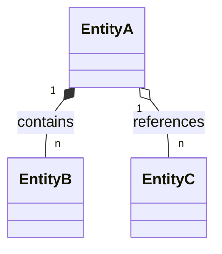

# {Product Name} - Software Requirements Specification (SRS)

| Version | Date | Author | Change |
|---------|------|--------|--------|
| 1.0 | {YYYY-MM-DD} | {Name} | Initial draft |

---

## Table of Contents

*(fill in after writing)*

---

## 1. Introduction
### 1.1 Purpose
### 1.2 Scope
### 1.3 Assumptions and Constraints
#### 1.3.1 Assumptions
#### 1.3.2 Constraints
### 1.4 Definitions and Acronyms
### 1.5 Roles and Actors

| Role | Description | Example persona |
|------|-------------|-----------------|
| {ROLE} | {One-line description of what this actor does in the system} | {Real-world example} |

### 1.6 Out of Scope
The following are explicitly excluded from this specification:
- {Feature or capability not covered}
- {Integration excluded}
- {Assumption about what a later phase handles}

### 1.7 Related Documents

| Document | Location | Purpose |
|----------|----------|---------|
| SDS | {path or URL} | Software Design Specification — architecture and API design |
| RUNBOOK | {path or URL} | Operational guide — setup, deployment, troubleshooting |

---

## 2. Conceptual Domain Model

> This section defines the "Universe of Discourse" — the real-world entities, their relationships,
> and business rules governing them. It uses business terminology only; implementation details
> (DB types, PKs, API field names) belong in the SDS.
>
> **Sync obligation:** whenever a user story in §7 introduces, renames, or removes a domain
> concept, this section MUST be updated in the same PR. Record the last review below.
>
> **Last synced with §7 User Stories:** {YYYY-MM-DD}

### 2.1 Domain Diagram

> **Notation:**
> - `*--` Solid diamond (◆) — **Composition**: child cannot exist without parent (strict lifecycle).
> - `o--` Hollow diamond (◇) — **Aggregation**: child exists independently (loose reference).
> - `-->` Plain arrow — **Association**: peer relationship with no ownership.
>
> **Aggregate Roots:** identify which entities are aggregate roots (the single entry point for
> a cluster of related entities). Mark them with `<<AggregateRoot>>` stereotype in the diagram.

### 2.2 Domain Entity 

| Entity | Description | Key Business Attributes | Ownership / Lifecycle |
|--------|-------------|-------------------------|-----------------------|
| {Entity Name} | {Real-world definition — what it represents in the business} | {Comma-separated list of business-meaningful properties, not DB fields} | {Independent / Part of X / Owned by Y} |

> **Tip:** "Key Business Attributes" are the properties a domain expert would use to describe the
> entity — e.g., for *Customer Session*: `product viewed, signals captured, intent score`.
> Avoid DB column names here.

### 2.3 Entity Relationship and Cardinality

| Subject | Verb Phrase | Object | Type | Cardinality | Constraint |
|---------|-------------|--------|------|-------------|------------|
| {Entity A} | {e.g., "contains"} | {Entity B} | Composition \| Aggregation \| Association | {1..1 \| 0..n \| 1..n} | {Business rule enforced by this relationship — e.g., "deleted when parent is deleted"} |

> **Type** must match the diagram notation. A Composition row means the child row in §2.1 uses `*--`.

### 2.4 Business Rules

> Business rules are invariants that the system must always enforce, regardless of which feature or
> user story triggers them. They are distinct from acceptance criteria (which are story-specific).
> Each rule here should be traceable to at least one AC in §7 or one FR in §3.

| Rule ID | Statement | Entities Involved | Enforced In |
|---------|-----------|-------------------|-------------|
| BR-{nn} | {Declarative statement of the rule — use MUST/MUST NOT} | {Comma-separated entity names} | {§3.x FR / §7.x.x US-ID / SDS §x} |

---

## 3. Functional Requirements (FR)

> Each FR subsection describes **what** the system must do in business terms. Include a **Rationale** to explain **why** — the business driver, user need, or risk the requirement addresses. Implementation details belong in the SDS.

### 3.1 {Function Name 1}
**Rationale:** {Why this requirement exists — the business driver, user need, compliance obligation, or risk it addresses.}

{Description of what the system must do.}

### 3.2 {Function Name 2}
**Rationale:** {Why this requirement exists.}

---

## 4. Non-Functional Requirements (NFR)

> Each NFR must carry a **measurable target** — a concrete number or threshold verifiable in testing. Prose descriptions without targets will be rejected at review.

### 4.1 Performance

| Metric | Target |
|--------|--------|
| {Operation or endpoint} | {< X ms at pYY percentile} |

### 4.2 Availability

| Environment | Uptime target |
|-------------|---------------|
| Production | {X%} |
| Staging / test | {X%} |

### 4.3 Scalability

| Dimension | POC target | MVP target | Production target |
|-----------|-----------|-----------|------------------|
| Concurrent sessions | {N} | {N} | {N} |

### 4.4 Security
#### 4.4.1 Authentication
#### 4.4.2 Authorization

### 4.5 Privacy
- {Privacy requirement — PII handling, data minimisation, sanitisation rules.}
- **Data Residency:** {Specify the geographic region(s) where personal data must be stored/processed.}

### 4.6 Reliability

| Failure scenario | Expected system behaviour |
|------------------|--------------------------|
| {What breaks} | {How the system recovers} |

---

## 5. User Experience Requirements (UXR)
### 5.1 Clarity
### 5.2 Fast Onboarding
### 5.3 Immediate Feedback

---

## 6. Business Flows

> These flows describe end-to-end journeys at a business level. Each named flow should include its happy path, alternative paths, and failure/negative cases.

### 6.1 Main Business Flow — End-to-End User Journey

### 6.2 Flow 1
#### Alternative Flows
- **{Alt flow name}:** {Description.}
#### Negative Flows
- **{Failure/error name}:** {Expected behavior.}

> **Forward traceability:** every step in a flow that requires a user action or a system decision
> MUST map to at least one User Story in §7. If a step has no corresponding story, either the
> story is missing or the step is purely internal — document which in a note on the step.

---

## 7. Features and User Stories

> **Derivation principle:** Features and User Stories are derived from two upstream sources —
> do not invent features that cannot be traced to one of these. If a feature has no trace,
> update §2 or §6 first.
>
> | Source | Drives | Typical story actions |
> |--------|--------|-----------------------|
> | **§2 Domain Entities** | Data-centric features | Create, view, update, delete an entity; trigger a state transition (§2.3) |
> | **§6 Business Flows** | Journey-centric features | Actor performs a step in a named flow; system responds to a flow event |
>
> A Feature that cannot be traced to either source is a signal that §2 or §6 is incomplete —
> update those sections before writing the stories.
>
> **User story format:** **As a** {ROLE}, **I want to** {action} **so that** {value}.
>
> All domain nouns used in stories MUST be defined in §2.2.
> All business rules cited in acceptance criteria MUST have a BR-{nn} entry in §2.4.

### 7.1 {Feature Name 1}

#### 7.1.1 [FN1-US-01]({JIRA_URL}/FN1-US-01): Create a {Domain Object}
**As a** {ROLE}, **I want to** create a {Domain Object} **so that** {value}.

**Acceptance Criteria:**
- [ ] {condition}
- [ ] {condition}

---

## 8. External Dependencies

### 8.1 Third-Party APIs

| Dependency | Provider | Purpose | Failure mode |
|------------|----------|---------|--------------|
| {Name} | {Vendor} | {Purpose} | {Impact} |

### 8.2 Internal Systems / Legacy Services

| Dependency | Owner team | Purpose | Failure mode |
|------------|-----------|---------|--------------|
| {Name} | {Team} | {Purpose} | {Impact} |

### 8.3 Infrastructure Dependencies

| Dependency | Type | Purpose | Failure mode |
|------------|------|---------|--------------|
| {Name} | {Managed} | {Purpose} | {Impact} |
