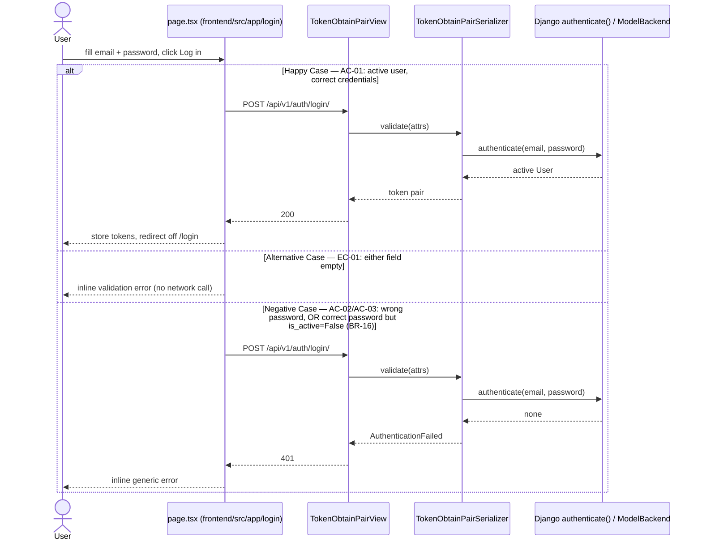

# Implementation Plan: System Security

**Branch**: `001-system-security` | **Spec**: [spec.md](spec.md)

**Input**: Feature specification from `specs/001-system-security/spec.md`

**User Stories covered by this plan**:

| Story | Status | Last updated |
|---|---|---|
| SS-US-01: Login | ✅ Designed & implemented | 2026-09-21 |
| SS-US-02: Logout | Not yet designed | — |

> This plan covers the whole **System Security** feature, not a single User Story — per aif-sdlc.md's Design Step, `plan.md` is created once per feature folder and *extended* (not replaced) each time a new US in this feature goes through `/speckit-plan`. `## Technical Context`, `## Constitution Check`, `## Project Structure`, and `## Complexity Tracking` below are feature-wide and will grow rows/entries as SS-US-02 (and beyond) are designed. Each User Story's own design — Summary, Decisions & Rationale, Domain Objects, API Contracts, Sequence Diagram, and Quickstart Validation — gets its own `### SS-US-NN` subsection under **User Story Plans** so they don't blend together.
>
> **No sibling design files.** This feature's design lives entirely in this one file — there is no separate `research.md`, `data-model.md`, `contracts/`, or `quickstart.md`. SS-US-01 was originally designed with those as four standalone files; on 2026-09-21 they were folded into the **SS-US-01: Login** section below (per the project's finalized convention — see `.specify/templates/plan-template.md`) and the standalone files were deleted. Nothing about SS-US-01's actual design changed in that move, only where it lives.

## User Story Plans

### SS-US-01: Login

**Summary**: Authenticate an ADMIN or USER by email + password and issue a JWT access/refresh credential pair, so the caller can reach the account and the actions permitted to their role(s) (AC-01). The backend side of this already exists as-is: `djangorestframework-simplejwt`'s stock `TokenObtainPairView` is wired at `POST /api/v1/auth/login/` (`backend/config/api_router.py`), and Django's default `ModelBackend` already refuses to authenticate a deactivated account (`is_active=False`), which is exactly BR-16/AC-03. No new backend service module is introduced — this is a case of AR-01's "straightforward CRUD/auth" threshold, not a multi-model side-effecting operation. What's actually missing is (1) a frontend login page — none exists yet under `frontend/src/app/` — and (2) test coverage + SDS documentation for the already-working endpoint.

#### Pre-flight: Spec Review Findings

*Recorded retroactively on 2026-10-08 — this plan predates the Pre-flight section of `plan-template.md`. Each finding is what was true when SS-US-01 was designed/built, with its current status.*

| ID | Type | AC | Finding | Resolution |
|----|------|----|---------|------------|
| G1 | **Gap** | AC-04 | "Single login covers dual roles" cannot be demonstrated while no `Role` entity exists. | Deferred, then **resolved by UM-US-01**: `roles.Role` / `user_roles` exist; TC-06 now seeds a real dual-role account and asserts one token works for an ADMIN action and a USER action, with a USER-only account as the control. |
| G2 | **Gap** | AC-01 | The spec does not say where the issued credentials are kept on the client. | the token-storage Decision below (recorded retroactively): `localStorage`. |
| G3 | **Gap** | AC-01..03 | Constitution § Logging & Audit asks for login success/failure logging; the stock view logs nothing. | Resolved 2026-10-08: thin `LoginView`/`LoginSerializer` subclass logs success at `INFO`; failures are logged at `WARN` with the acting User id (none, for a login) by `config.exceptions.api_exception_handler`. Neither line contains the email or the password. |
| A1 | Ambiguity | EC-03 | "Session/credential expiry" is listed as an Edge Case but defers its outcome. | Left out of scope (spec Out of Scope); to be revisited with SS-US-02 Logout. |
| A2 | Ambiguity | AC-02, EC-01 | FE-06 asks for inline field-level feedback; the spec's copy ("Invalid email or password.", "Email and password are required.") is form-level by design — field-level text would reveal which field was wrong (AC-02). | The login form deliberately uses one form-level `#message-error`. |
| A4 | Gap (added 2026-10-08) | EC-04 | Login matched the email exactly, so an account created as `Homer@Example.com` only logged in with that spelling. | Spec amended (EC-04); a ~15-line `users.backends.EmailBackend` (`ModelBackend` subclass, `email__iexact` lookup) replaces the default backend in `AUTHENTICATION_BACKENDS`. Creation already forbids two accounts that differ only in capitalization (UM-US-01 EC-07), so the lookup cannot be ambiguous; if legacy data did produce two, neither can log in. |
| A3 | Ambiguity | AC-02 | Should a network failure or a `5xx` look like a credential error? | No: only `400`/`401` show "Invalid email or password."; anything else shows a neutral error (fixed 2026-10-08, code and tasks.md T011). |

*Pre-flight Gaps checklist*
- [x] Zero spec gaps flagged — or flagged gaps were resolved before this `plan.md` was reviewed
- [x] If significant gaps or ambiguity remain after review, the work goes back to the Spec step rather than being patched forward here
- [x] Design scope matches the US being designed — no scope creep into unrelated stories

#### Decisions & Rationale

No `[NEEDS CLARIFICATION]` markers remained in Technical Context below, so this phase confirms existing decisions already fixed by the constitution rather than evaluating new alternatives.

- **Decision**: Reuse `djangorestframework-simplejwt`'s `TokenObtainPairView` and serializer unchanged except for one `INFO` log line on success — a ~10-line `users/auth.py` (`LoginView` / `LoginSerializer`), no custom authentication logic. *(Originally the unmodified stock view; the subclass was added 2026-10-08 to satisfy § Logging & Audit.)*
  **Rationale**: `POST /api/v1/auth/login/` is already wired to `TokenObtainPairView`. It authenticates via Django's `authenticate()`, which delegates to `ModelBackend.user_can_authenticate()` — this already rejects `is_active=False` accounts (AC-03/BR-16) and returns one generic error message for both wrong-credentials and deactivated-account cases (AC-02), with no per-field detail leaked. Constitution AR-01 reserves a dedicated service module for logic spanning more than one model or with side effects (e.g. budget recompute, notification fan-out) — login has neither, so introducing an `AuthenticationService` would violate Simplicity Over Premature Scale.
  **Alternatives considered**: A custom login `APIView` + service function — rejected: duplicates behavior the stock view already provides correctly. Session-based auth — rejected: constitution API-07 already fixes JWT Bearer as the auth mechanism project-wide.

- **Decision**: Frontend login page uses native `fetch` + React state, no form library.
  **Rationale**: Constitution FE-02 forbids adding React Hook Form/Formik/Zod until complexity genuinely warrants it. A 2-field (email, password) login form with HTML5 `required` validation is well within native handling. FE-08 fixes direct `fetch` calls to `NEXT_PUBLIC_API_URL` — no API-proxy route.
  **Alternatives considered**: React Hook Form — rejected: no repeated ad hoc duplication problem yet to justify the dependency (same reasoning as FE-04).

- **Decision**: Token storage is client-side, with no specific cookie/session mechanism mandated by this US.
  **Rationale**: No existing frontend auth pattern exists in this codebase yet to follow. The simplest mechanism consistent with FE-08 (direct fetch, `Authorization: Bearer <token>` header per API-07) is storing the returned `access`/`refresh` tokens in the browser and attaching `access` as a Bearer header on subsequent requests. The concrete choice (e.g. in-memory vs. persisted) is an implementation-time detail for `tasks.md`, not a spec-level or business-rule concern.
  **Outcome (recorded 2026-10-08)**: implemented as `localStorage` under `pfm_access_token` / `pfm_refresh_token`; the Dashboard guard and the Create User page (UM-US-01) read the access token from there and redirect to `/login` when it is absent.
  **Alternatives considered**: `HttpOnly` cookies set by the backend — not chosen: needs a cookie-issuing/CSRF design on the backend and contradicts FE-08/API-07's plain Bearer header for now. In-memory storage — rejected: the User would have to log in again on every reload.
  **Known risk**: any script injected into the page (XSS) can read both tokens, including the 7-day refresh token. Accepted for the single-household home-LAN deployment; revisit (cookie-based storage, shorter refresh lifetime) when SS-US-02 Logout is designed, since logout must also clear this storage.

- **Open items — resolved during Implementation**: SDS §6.3 API Index / §6.4 API Specification now list `POST /auth/login/` (API-SS-01) and `POST /auth/refresh/` (API-SS-02) — added in tasks.md T014. SDS §4.3.3's BR-16 row now references the actual Django `ModelBackend` mechanism instead of a nonexistent `AuthenticationService` — corrected in tasks.md T015.

#### Domain Objects

No schema change is required for this US — it reads the existing `User` entity only.

| Domain Entity (SRS §2) | Model / Table | Key Fields | Notes |
|---|---|---|---|
| `User` | `users.User` / `users` table | `email` (`USERNAME_FIELD`, unique), `password` (hashed, from `AbstractUser`), `is_active` (`BooleanField`, default `True`, from `AbstractUser`) | `email` is the login identifier submitted by the caller. `password` is verified against the submitted value by Django's `authenticate()`. `is_active=False` makes `ModelBackend.user_can_authenticate()` refuse authentication regardless of correct credentials (AC-03, BR-16). |

Login does not read or branch on Role: the token it issues carries no role information, and AC-04 (dual-role single login) holds because authorization is decided per request from the roles the account holds (`roles.Role` / `user_roles`, added by UM-US-01; `IsAdmin` for ADMIN-only endpoints). TC-06 therefore seeds a real dual-role account and proves one token works for an ADMIN action and a USER action, with a USER-only account as the control.

**State Transitions**: None triggered by login itself. `is_active` transitions (`ACTIVE` → `INACTIVE`) belong to UM-US-05 (Deactivate User), not this US — login only *reads* the current state.

*Data Modeling checklist*
- [x] Entity/field names match SRS §2 domain language verbatim (NC-01) — no synonyms
- [x] No new Domain Entity introduced — SDS §2.1 traceability table needs no change
- [x] No divergence from SDS §2.2/§4.3.3 introduced by this US

#### API Contracts

**`POST /api/v1/auth/login/`**

Maps to spec.md AC-01, AC-02, AC-03, EC-01, EC-04. Already implemented (stock `TokenObtainPairView`) — documented here for traceability into SDS §6.4.

| Field | Type | Notes |
|---|---|---|
| `email` | string | required |
| `password` | string | required |

| Status | Body | Maps to |
|---|---|---|
| 200 | `{"access": "<JWT, 1 hour lifetime>", "refresh": "<JWT, 7 day lifetime>"}` | AC-01, AC-04 (no role-specific field — same shape regardless of which role(s) the account holds) |
| 400 | DRF default `{field: [messages]}` | EC-01 (`email` or `password` missing) |
| 401 | `{"detail": "No active account found with the given credentials"}` — one generic message, does not distinguish which case or which field | AC-02, AC-03 |

**`POST /api/v1/auth/refresh/`**

Out of scope for SS-US-01's acceptance criteria (no AC references token refresh) — documented here only because it is the paired endpoint the login response's `refresh` token is used against. Already implemented via stock `TokenRefreshView`.

*API Design checklist*
- [x] Endpoint is versioned under `/api/v1/`, matches existing convention (API-01)
- [x] Response shape follows API-02 — no custom envelope
- [x] Status codes follow the API-04 mapping table
- [x] No sensitive field (e.g. `password`) ever appears in a response (AC-04 access-control sense / field-level filtering)

#### Sequence Diagram

Covers AC-01 (success), AC-02/AC-03 (generic rejection — wrong credentials and deactivated account both take the same path), and EC-01 (missing field, rejected before any network call).



#### Business Rules Enforced

| Code | Rule | Source | Enforcement |
|---|---|---|---|
| BR-16 | A deactivated account cannot authenticate even with correct credentials | SRS §2.4 BR-16 / AC-03 | Django's `ModelBackend.user_can_authenticate()`, invoked transparently by `TokenObtainPairSerializer.validate()` → `401` generic error |

#### Element IDs

| Element | ID | Status | File |
|---|---|---|---|
| Email input | `login-email` | Done | `frontend/src/app/login/page.tsx` |
| Password input | `login-password` | Done | `frontend/src/app/login/page.tsx` |
| Submit button | `btn-submit-login` | Done | `frontend/src/app/login/page.tsx` |
| Error message container | `message-error` | Done | `frontend/src/app/login/page.tsx` |

#### Quickstart Validation

**Prerequisites**: Backend running (`cd backend && .venv\Scripts\activate && python manage.py runserver`); at least one active User account exists (an ADMIN via `python manage.py createsuperuser`, then the account under test created by that ADMIN with `POST /api/v1/users/` — UM-US-01; the endpoint is no longer public).

- **AC-01 — successful login issues credentials**:
  `curl -X POST http://localhost:8000/api/v1/auth/login/ -H "Content-Type: application/json" -d '{"email": "<existing-active-user-email>", "password": "<correct-password>"}'`
  Expected: `200`, body contains `access` and `refresh` tokens.
- **AC-02 — invalid credentials rejected generically**:
  Same call with a wrong password. Expected: `401`, single generic `detail` message — does not say "wrong password" specifically.
- **AC-03 — deactivated account rejected**:
  `python manage.py shell -c "from users.models import User; u = User.objects.get(email='<email>'); u.is_active = False; u.save()"`, then the AC-01 call with the correct password. Expected: `401`, same generic message as AC-02 — does not reveal the account is deactivated.
- **AC-04 — dual-role account, single login**: No separate flow to test — create a User, log in once, assign the account both the `ADMIN` and `USER` roles, then confirm the returned token creates a User (`POST /api/v1/users/`, ADMIN-only → `201`) and lists Wallets (`GET /api/v1/wallets/` → `200`), while a USER-only account's token gets `403` on the first.
- **EC-01 — missing field**:
  Same call with `password` omitted. Expected: `400`, field-level validation error for `password`.
- **Frontend** (once `frontend/src/app/login/page.tsx` exists): `cd frontend && npm run dev` → open `http://localhost:3000/login` → submit valid credentials → redirected to Dashboard, tokens stored; submit invalid credentials → inline `#message-error` shown, form remains.

*(Implementation-level task breakdown for SS-US-01 lives in `tasks.md`, not repeated here.)*

#### Open tasks

*Implementation-level breakdown lives in `tasks.md`; this table maps the design to it. All done.*

| ID | Task | File |
|----|------|------|
| T1 | Confirm the login/refresh routes and `djangorestframework-simplejwt` wiring (`tasks.md` T001) | `backend/config/api_router.py` |
| T2 | `APITestCase`s for AC-01..AC-04, EC-01, EC-02, the unregistered-email case and login logging (`tasks.md` T002–T008; TC-10/TC-11 added 2026-10-08) | `backend/users/tests.py` |
| T3 | Login page with the Element IDs above (`tasks.md` T009–T013) | `frontend/src/app/login/page.tsx` |
| T4 | Login success log line and 401/403 `WARN` logging | `backend/users/auth.py`, `backend/config/exceptions.py` |
| T5 | SDS §6.3/§6.4 and §4.3.3 BR-16 doc sync; Playwright runner and e2e suite (`tasks.md` T014–T018) | `SDS.md`, `e2e/` |

### SS-US-02: Logout

*(Not yet designed — add a `### SS-US-02: Logout` section here, following the same subsection structure as SS-US-01 above, when this US goes through the Design Step.)*

## Technical Context

**Language/Version**: Python 3.12 (Django 6.0.7) for backend; TypeScript 5 (Next.js 16.2.10, React 19.2.4) for frontend

**Primary Dependencies**: Django REST Framework 3.17.1, `djangorestframework-simplejwt` 5.5.1 (backend, already installed and wired); no new frontend dependency — native `fetch` + React state per FE-02/FE-08 (no HTTP client, no form library)

**Storage**: SQLite (MVP) — `users` table already exists (`AUTH_USER_MODEL = 'users.User'`), no schema change required for this US

**Testing**: `python manage.py test` (DRF `APITestCase`, real throwaway test DB per constitution's Integration Testing Over Mocking); Playwright e2e (`e2e/001-system-security/test_ss.spec.ts`, runner `e2e/playwright.config.ts`) for the login page

**Target Platform**: Single-machine home-LAN deployment (RUNBOOK.md) — backend :8000, frontend :3000

**Project Type**: Web application (frontend + backend), matching Option 2 below

**Performance Goals**: None beyond SRS §4 defaults (no story-specific target; login is a single low-frequency request, not a hot path)

**Constraints**: Access token lifetime 1 hour / refresh token lifetime 7 days (`SIMPLE_JWT` in `config/settings.py`, already fixed by constitution API-07) — not to be changed by this US

**Scale/Scope**: Single shared home-LAN instance, small fixed number of family-member accounts (SRS §1.4) — no concurrency/load design needed

## Constitution Check

*GATE: Must pass before Decisions & Rationale. Re-check after Domain Objects/API Contracts design.*

| Principle | Status | Notes |
|---|---|---|
| AR-01 Service Layer for Non-Trivial Business Logic | ✅ PASS | Login is single-model, no side effects on other Aggregates → stays in the stock DRF/SimpleJWT view, no new `services.py` needed |
| AR-02 Thin Views | ✅ PASS | `TokenObtainPairView` is already thin; no custom view logic introduced |
| AR-03 Django ORM Is the Repository | ✅ PASS | No repository abstraction introduced |
| AR-05 Transactional Atomicity | N/A | Single read, no multi-model write |
| AC-01/AC-02 Role-Based Access, Backend Enforces Authorization | ✅ PASS (scoped) | Login itself grants no role-specific permissions; roles are evaluated per request (`IsAdmin`, UM-US-01), which is what makes AC-04 (dual role, single login) true and testable |
| API-02 Response Shape — DRF-Native | ✅ PASS | `TokenObtainPairView` returns the stock `{access, refresh}` body, no custom envelope |
| API-04 HTTP Status Mapping | ✅ PASS | 200 success, 401 for bad credentials/deactivated account (SimpleJWT default) |
| API-07 Authentication | ✅ PASS | Already the fixed mechanism this US formalizes |
| Simplicity Over Premature Scale | ✅ PASS | Explicitly rejects adding an `AuthenticationService` module (see Decisions & Rationale) |
| VL-01 Backend Is Source of Truth | ✅ PASS | Frontend HTML5 required-field checks are UX-only; DRF/SimpleJWT validation is authoritative |
| Logging & Audit | ✅ PASS | Login success logged at `INFO` (`users.auth`); `401`/`403` logged at `WARN` with the acting User id by `config.exceptions.api_exception_handler`; no email, password or token in any line (TC-11) |
| Security Requirements (no secrets in source, token handling) | ⚠ ACCEPTED RISK | Client-side token storage in `localStorage` — see the token-storage Decision's "Known risk" |
| DOD-02 API Contract Documented | ✅ RESOLVED | `POST /auth/login/` (API-SS-01) and `POST /auth/refresh/` (API-SS-02) added to SDS §6.3 API Index and §6.4.7/§6.4.8 API Specification during the Implementation Step (tasks.md T014) |
| Cross-Document Consistency (BR-16 mapping) | ✅ RESOLVED | SDS §4.3.3's BR-16 row corrected during the Implementation Step (tasks.md T015) to name Django's `ModelBackend.user_can_authenticate()`, invoked transparently by `TokenObtainPairSerializer.validate()`, instead of the nonexistent `AuthenticationService` |

No unjustified violations — Complexity Tracking table is empty.

## Project Structure

### Documentation (this feature)

```text
specs/001-system-security/
├── plan.md              # This file — Decisions & Rationale, Domain Objects, API Contracts,
│                         #   and Quickstart Validation live per-US inside this file (no sibling
│                         #   research.md/data-model.md/contracts//quickstart.md)
├── test_cases.md         # Quality Step (TC-01..TC-11)
├── checklists/requirements.md
└── tasks.md              # /speckit-tasks output
```

### Source Code (repository root)

```text
# Option 2: Web application (frontend + backend) — matches this repo's actual layout

backend/
├── config/
│   ├── api_router.py     # POST /auth/login/ → users.auth.LoginView, POST /auth/refresh/ → TokenRefreshView
│   ├── exceptions.py     # logs 401/403 at WARN with the acting User id
│   └── settings.py       # existing: SIMPLE_JWT lifetimes, AUTH_USER_MODEL
├── users/
│   ├── models.py         # existing: User(AbstractUser), USERNAME_FIELD='email', is_active
│   ├── auth.py           # LoginView / LoginSerializer — stock login + success log line
│   └── tests.py          # DONE (SS-US-01): APITestCase covering AC-01..AC-04, EC-01, EC-02

frontend/
└── src/app/
    ├── login/
    │   └── page.tsx      # DONE (SS-US-01): login form (email, password), calls POST /api/v1/auth/login/,
    │                      #                  stores access/refresh tokens, redirects off /login on success
    └── logout/           # SS-US-02, not yet designed
        └── ...
```

**Structure Decision**: Web application layout (Option 2). SS-US-01 needed no new backend module — only the frontend login page plus backend test coverage for the endpoint that already exists. SS-US-02 (Logout) will add its own entry here once designed.

## Complexity Tracking

*No violations — table intentionally empty.*
</content>
