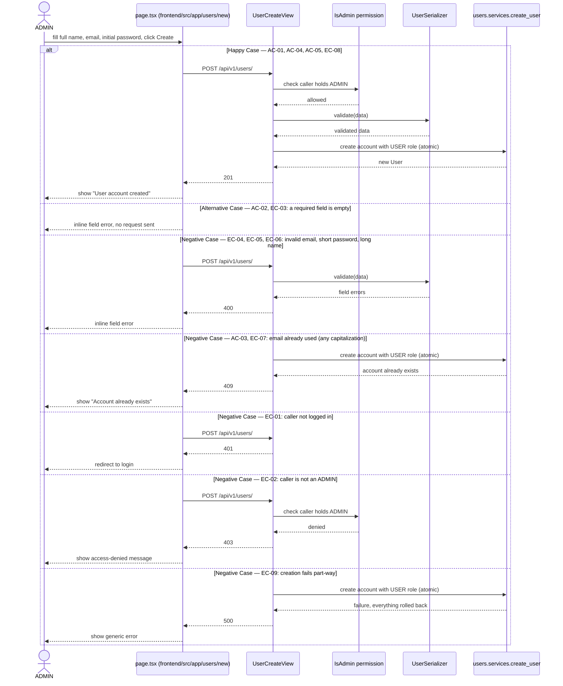

# Plan: User Management (UM)

> **Feature:** 7.2 User Management
> **Spec:** [spec.md](spec.md)
> **SDS §5.2:** [SDS.md §5.2](../../SDS.md#52-user-management-um)

**Note**: This file is generated and extended by the `/speckit-plan` command — one `## [CODE]-US-NN` section
per user story, appended in the order stories are designed. When `plan.md` already exists for this feature,
**append** the new US section below the existing ones — never delete, rewrite, or renumber a previously
completed US section.

**No sibling design files.** This feature's whole design (why, what, and how to verify it) lives in this one
file — there is no separate `research.md`, `data-model.md`, `contracts/`, or `quickstart.md`.

**User Stories covered by this plan**:

| Story | Status | Last updated |
|---|---|---|
| UM-US-01: Create a User (ADMIN) | Designed & implemented | 2026-10-08 |
| UM-US-02 .. UM-US-06 | Not yet designed | — |

---

## UM-US-01: Create a User (ADMIN)

### Pre-flight: Spec Review Findings

Reviewed `spec.md` and the existing implementation (`backend/users/`, `backend/config/`, `frontend/src/app/`) before design. The following gaps and ambiguities were identified.

| ID | Type | AC | Finding | Resolution |
|----|------|----|---------|------------|
| G1 | **Gap** | EC-02, AC-04 | The story needs to tell an `ADMIN` from a `USER`, but no `Role` entity exists (constitution's documented open drift; `users.User` is a plain `AbstractUser`). | Scaffold the `roles` app (`Role`, seeded `ADMIN`/`USER`) and a `User ↔ Role` many-to-many through a `user_roles` table, as SDS §2.2.11 / §2.3.14 / §4.3.3 already design. Decision D2. |
| G2 | **Gap** | AC-01 | There must already be an `ADMIN` for anyone to create the first account. SDS §4.3.3 *Migration Strategy* says a seed migration bootstraps the first ADMIN `user`; CLAUDE.md / RUNBOOK §9 say there are **no seeded credentials** and the first ADMIN comes from `createsuperuser`. | Follow CLAUDE.md/RUNBOOK (no credentials in a migration): the seed migration inserts only the two `roles` rows, and `createsuperuser` grants the `ADMIN` role. SDS Migration Strategy and RUNBOOK §9 are amended in the implementation PR. Decision D3. |
| G3 | **Gap** | AC-01, EC-08 | The spec asks for a *full name*, SDS §2.2.1 specifies `full_name`, but the model only has Django's `username` / `first_name` / `last_name`. | Add `full_name` (≤150 chars). `username` is a required, unique `AbstractUser` column that SDS does not list; it is filled from the email (login uses `email`). |
| G4 | **Gap** | AC-03, EC-07 | "Account already exists" has no catalogued error code, and the status is not stated. | `409` per API-04; new code `USER_ALREADY_EXISTS` added to SDS §6.6 in the implementation PR (API-03). Duplicate check is case-insensitive (EC-07). Decision D5. |
| G5 | **Gap** | AC-04 | The story does not say which role the new account gets, yet SDS §4.3.3 requires every User to have at least one Role. | Always `USER`; granting `ADMIN` is declared out of scope in the spec. |
| G6 | **Gap** | EC-04 | The `username` column is limited to 150 characters but `email` allows 254, so a long email could not be used as the `username`. | Cap the email at 150 characters and report "Enter a valid email address" (spec EC-04 wording amended in this step). |
| G7 | **Gap** | — | SDS §2.3.2 (line ~416) says an `InvestmentPortfolio` is created when the ADMIN creates a User. That app is not scaffolded and no AC covers it. | Deferred — the `create_user` service function is the single place to add it when `investment_portfolios` exists. Not part of this story. |
| G8 | **Gap** (resolved) | EC-01, EC-02 | **Existing code contradicts the SRS.** `POST /api/v1/users/` is public (`AllowAny`, "registration is public"), `GET /api/v1/users/` lists every account publicly, and `users/<id>/` (`UserDetailView`) lets any authenticated caller read, update or delete any User. SRS §7.2 and §1.6 say there is no self-service registration. | This story makes `POST /api/v1/users/` `ADMIN`-only and removes the public `GET` list (UM-US-04 will re-add it as ADMIN-only). `UserDetailView` was first left unchanged as belonging to UM-US-02/03/05/06 and recorded as a known open risk; **a live probe then showed any logged-in User could overwrite or delete any account (password stored unhashed), so the view and its `users/<id>/` route were removed (2026-10-08)** — each later UM story adds its own permission-checked endpoint. Regression test TC-20. Constitution §V and CLAUDE.md drop `POST /api/v1/users/` from the public route list. |
| G9 | **Gap** | EC-02 | FE-03 wants the Create User entry hidden from non-ADMINs, but the screen cannot know the caller's role (login returns only tokens; no profile endpoint until UM-US-03). | Deferred (spec Out of Scope). The page is reachable at `/users/new`, is not linked from the Dashboard, and shows an access-denied message on `403`; the backend is authoritative (AC-02). |
| A1 | Ambiguity | AC-01 | "the new User can log in" — no login screen is involved in this story. | Verified at the API level (SS-US-01 login endpoint) and e2e via the existing Login page. |
| A2 | Ambiguity | AC-01..03 | Message text ("User account created", "Email is required", "Account already exists") — UI copy or API text? | Both: the API returns these strings (`email` field error / `409` `detail`); the page shows the API text and also checks required fields before submitting. |
| A3 | Ambiguity | AC-01 | Existing tests and the SS-US-01 e2e suite create accounts through the *public* `POST /api/v1/users/`. | Re-based: Django tests create fixtures with the ORM, the e2e suite logs in as an `ADMIN` supplied through environment variables. See Open tasks T9/T11. |

> No gap blocks the design. G6 required one wording change to the spec (EC-04), made in this step.

*Pre-flight Gaps checklist*
- [x] Zero spec gaps flagged — or flagged gaps were resolved before this `plan.md` was reviewed
- [x] If significant gaps or ambiguity remain after review, the work goes back to the Spec step rather than being patched forward here
- [x] Design scope matches the US being designed — no scope creep into unrelated stories

---

### Decisions & Rationale

- **Decision D1**: A service function `users/services.py::create_user()` performs the creation.
  **Rationale**: AR-01 — the use case spans more than one model (`User` + the `user_roles` link) and carries business rules beyond field validation (duplicate check, default `USER` role); AR-05 — the writes must be one `transaction.atomic()` so no User is ever left without a Role (EC-09). The View only binds HTTP and delegates.
  **Alternatives considered**: Doing it in `UserSerializer.create()` — rejected by AR-01 (more than one model, side effects).

- **Decision D2**: New app `roles` (`Role` model, `roles` table, `code` ∈ `ADMIN`/`USER`), linked to `User` by `ManyToManyField` using the join table `user_roles`.
  **Rationale**: constitution § Package-by-Feature (one app per entity) and SDS §2.2.11/§2.3.14/§4.3.3, which also let one person hold both roles (SRS §1.5). A seed data migration inserts the two rows so `Role` is always present.
  **Alternatives considered**: `is_staff`/`is_superuser` flags — rejected: they are Django admin-site flags, cannot express "both roles", and SS-US-01's TC-06 already shows the weakness of using them as a proxy.
  **Note**: `Role.code` values are upper-case (`ADMIN`, `USER`), an exception to NC-05's lower-case rule, because they are the literal role names used across SRS/SDS/constitution and the SDS `CHECK (code IN ('ADMIN','USER'))`. Primary key stays the default integer (documented open drift; no `uuid` introduced in one app only).

- **Decision D3**: The first `ADMIN` comes from `createsuperuser`, which also grants the `ADMIN` role (custom `UserManager.create_superuser`); the seed migration holds no credentials.
  **Rationale**: Security Requirements — no secrets or credentials in source; CLAUDE.md/RUNBOOK §9 already say there is no seeded default account.
  **Alternatives considered**: A migration that creates the first ADMIN (SDS §4.3.3's current text) — rejected: it needs a hard-coded or generated password.

- **Decision D4**: A DRF permission class `IsAdmin` in `config/permissions.py` (cross-cutting, shared by every later ADMIN-only story) allows a request only if the authenticated User holds the `ADMIN` role.
  **Rationale**: AC-02 — authorization enforced in the backend; unauthenticated → `401` from the default `IsAuthenticated` ordering, non-ADMIN → `403`.
  **Alternatives considered**: An inline role check in the View — rejected: would be copied into UM-US-04/05/06 and AM-US-*.

- **Decision D5**: Duplicate email → `409` `{"detail": "Account already exists", "code": "USER_ALREADY_EXISTS"}`, checked case-insensitively in the service, and a database `IntegrityError` from a race is mapped to the same response.
  **Rationale**: API-03/API-04/VL-02 — a clear business error, never a `500`; the `email` column's unique constraint remains the final guard against two simultaneous submissions.
  **Alternatives considered**: DRF's `UniqueValidator` (`400`, case-sensitive) — rejected: wrong status for a business conflict and misses EC-07.

- **Decision D6**: The email is stored as submitted (Django's `normalize_email` only), not lower-cased.
  **Rationale**: Login (`ModelBackend`) looks the email up with an exact match; lower-casing only at creation would silently change which spelling logs in. The case-insensitive duplicate check still prevents near-duplicates (EC-07).
  **Alternatives considered**: Lower-casing everywhere (create + login) — rejected for this story: changes SS-US-01's behavior.

- **Decision D7**: Frontend `frontend/src/app/users/new/page.tsx` uses native `fetch` + React state, no form library.
  **Rationale**: FE-02, FE-08. The page sends `Authorization: Bearer <pfm_access_token>` (token storage as shipped by SS-US-01), checks required fields before submitting (AC-02, EC-03), shows the API's field messages inline (FE-06), disables the button while submitting, and redirects to `/login` on `401`.

---

### Domain Objects

| Domain Entity (SRS §2) | Model / Table | Key Fields | Notes |
|--------|-------|------------|-------|
| `User` | `users.User` / `users` | `id`, `full_name` (**new**, `CharField(150)`), `email` (unique, ≤150), `username` (from `AbstractUser`, set to the email), `password` (hashed), `is_active` (default `True`), `date_joined` (serialized as `created_at`), `roles` (**new** many-to-many → `roles.Role`, join table `user_roles`) | Migration `users/0002`: add `full_name` (existing rows backfilled with `''`) and the `roles` relation. A new account is always `is_active = true` (SDS §2.4 User STD initial state). |
| `Role` (SRS §1.5; SDS §2.2.11) | `roles.Role` / `roles` | `id`, `code` (`ADMIN` \| `USER`, unique) | **New app.** Migration `roles/0001` creates the table; `roles/0002` seeds the two rows. Join table `user_roles` has `user_id`, `role_id` and a unique pair (Django adds its own integer `id`; SDS describes a composite PK — equivalent for uniqueness). |

**State Transitions**: creation puts a User in `ACTIVE`; later transitions belong to UM-US-05.

*Data Modeling checklist*
- [x] Entity/field names match SRS §2 domain language verbatim (NC-01) — no synonyms
- [x] If a new Domain Entity is introduced: SDS §2.1 Domain Layer Traceability table is updated in the same PR (`Role`/`user_roles` rows already exist; "implementation class" notes are finalised in the implementation PR)
- [x] Primary keys, enum casing, and any other divergence from SDS §2.2/§4.3.3 follow the project's documented "Known open drift" — no `uuid` PK introduced; `Role.code` casing is the justified exception recorded in D2
- [x] New indexed query pattern → none (the `email` unique index already serves the duplicate check; `iexact` on a short table needs no extra index at household scale)

---

### API Contracts

**`POST /api/v1/users/`** — `ADMIN` only. Maps to UM-US-01.

| Field | Type | Notes |
|---|---|---|
| `full_name` | string | required, ≤150 characters |
| `email` | string | required, valid email, ≤150 characters, must not match an existing account (case-insensitive) |
| `password` | string | required, ≥8 characters, write-only |

| Status | Body | Maps to |
|---|---|---|
| 201 | `{"id", "full_name", "email", "is_active", "created_at"}` — never `password` | AC-01, AC-04, AC-05, EC-08 |
| 400 | DRF default `{field: [messages]}` — e.g. `{"email": ["Email is required"]}`, `{"full_name": ["Full name is required"]}`, `{"password": ["Password is required"]}`, `{"email": ["Enter a valid email address"]}`, `{"password": ["Password must be at least 8 characters"]}`, `{"full_name": ["Full name must be at most 150 characters"]}` | AC-02, EC-03, EC-04, EC-05, EC-06 |
| 401 | `{"detail": "Authentication credentials were not provided."}` (SimpleJWT/DRF default) | EC-01 |
| 403 | `{"detail": "You do not have permission to perform this action."}` (DRF default) | EC-02 |
| 409 | `{"detail": "Account already exists", "code": "USER_ALREADY_EXISTS"}` | AC-03, EC-07 |
| 500 | unexpected failure — transaction rolled back, nothing persisted | EC-09 |

`GET /api/v1/users/` (previously public) and `/api/v1/users/<id>/` (previously open to any logged-in caller) are removed; UM-US-04 introduces the ADMIN-only list and UM-US-02/03/05/06 the by-id endpoints.

*API Design checklist*
- [x] Endpoint is versioned under `/api/v1/`, plural lowercase (kebab-case if multi-word) resource name (API-01, NC-02)
- [x] Response shape follows API-02 — no custom envelope; list endpoints use DRF `PageNumberPagination` (no list endpoint remains in this story)
- [x] Status codes follow the API-04 mapping table
- [x] A state transition uses its own explicit action endpoint (API-05) — none introduced
- [x] A semantic business-rule error already catalogued in SDS §6.6 raises the matching `APIException` subclass (API-03); the new `USER_ALREADY_EXISTS` is added to SDS §6.6 in the implementation PR
- [x] Serializer `fields` list is explicit and matches the SDS §6.2 DTO Registry (AR-04, PF-02) — no `password` or other sensitive field ever exposed (AC-04)

---

### Sequence Diagram — Create a User



*Sequence Diagrams checklist*
- [x] Arrows follow correct logical order; every action arrow has a matching return arrow
- [x] Arrow labels describe the action/intent, not a method name or UI click target
- [x] Each `alt` block is tagged with the AC/EC it demonstrates
- [x] No direct SQL/ORM calls or method signatures appear on the diagram — only actor-level actions (View/Serializer/Service granularity at most)

---

### Business Rules Enforced

| Code | Rule | Source | Enforcement |
|------|------|--------|-------------|
| *(SRS §1.6 / §7.2 intro)* | No self-service registration — only an ADMIN creates User accounts | SRS §7.2 | `IsAdmin` permission on `UserCreateView` → `401` / `403` |
| *(no SRS BR yet — SDS §4.3.3)* | Every User has at least one Role | SDS §4.3.3 | `create_user()` links the `USER` role inside `transaction.atomic()`; a failure rolls the User back (EC-09) |
| *(no SRS BR yet)* | One account per email | SRS §7.2.1 AC-03 | `create_user()` case-insensitive check + `users.email` unique constraint → `409 USER_ALREADY_EXISTS` |
| BR-16 | Only an active account can authenticate | SRS §2.4 BR-16 | New accounts are created `is_active = true`, so the new User can log in (AC-01) — enforcement itself lives in SS-US-01 |

*Naming & Layered Architecture checklist*
- [x] Straightforward ownership-scoped CRUD stays in the View + Serializer — not applicable here; this story is not plain CRUD (D1)
- [x] Logic spanning more than one model with a business rule moves into a plain module-level `users/services.py` function, not inline in the View or `Serializer.create()`
- [x] Views stay thin — HTTP binding and the permission check only (AR-02)
- [x] No hand-written Repository class wrapping the Django ORM (AR-03)
- [x] Multi-model writes are wrapped in `transaction.atomic()` (AR-05)
- [x] Every list/detail/update/delete View filters its queryset by the authenticated User (AC-03) — no such view is added; `UserDetailView` is flagged in G8

---

### Element IDs

| Element | ID | Status | File |
|---------|----|--------|------|
| Full name input | `user-full-name` | Done | `frontend/src/app/users/new/page.tsx` |
| Email input | `user-email` | Done | `frontend/src/app/users/new/page.tsx` |
| Initial password input | `user-password` | Done | `frontend/src/app/users/new/page.tsx` |
| Field error (per field) | `user-full-name-error`, `user-email-error`, `user-password-error` | Done | `frontend/src/app/users/new/page.tsx` |
| Create button | `btn-submit-user` | Done | `frontend/src/app/users/new/page.tsx` |
| Success message | `message-success` | Done | `frontend/src/app/users/new/page.tsx` |
| Error message | `message-error` | Done | `frontend/src/app/users/new/page.tsx` |
| Access-denied message | `message-access-denied` | Done | `frontend/src/app/users/new/page.tsx` |

---

### Quickstart Validation

**Prerequisites**: backend running; an `ADMIN` account exists (`cd backend && python manage.py createsuperuser`, which also grants the `ADMIN` role); one login to get a token:
`curl -X POST http://localhost:8000/api/v1/auth/login/ -H "Content-Type: application/json" -d '{"email":"<admin-email>","password":"<admin-password>"}'` → note `access` as `<ADMIN_TOKEN>`.

- **AC-01**: `curl -X POST http://localhost:8000/api/v1/users/ -H "Authorization: Bearer <ADMIN_TOKEN>" -H "Content-Type: application/json" -d '{"full_name":"Homer Truong","email":"homer@example.com","password":"Initial-Pass1"}'` → `201`, body has `id`, `full_name`, `email`, `is_active: true`, `created_at`; then the SS-US-01 login call with that email/password returns `200`.
- **AC-02**: same call without `email` → `400 {"email": ["Email is required"]}`.
- **AC-03**: repeat the AC-01 call → `409 {"detail": "Account already exists", "code": "USER_ALREADY_EXISTS"}`.
- **AC-04**: log in as the new User and repeat the AC-01 call with that token and a different email → `403`.
- **AC-05**: the AC-01 response body contains no `password` key.
- **EC-01**: AC-01 call with no `Authorization` header → `401`.
- **EC-02**: AC-01 call with the new USER's token (AC-04 above) → `403`, and no new account exists.
- **EC-03**: omit `full_name` → `400` with `full_name` error; omit `password` → `400` with `password` error.
- **EC-04**: `"email":"not-an-email"` → `400 {"email": ["Enter a valid email address"]}`.
- **EC-05**: `"password":"short"` → `400 {"password": ["Password must be at least 8 characters"]}`.
- **EC-06**: `full_name` of 151 characters → `400 {"full_name": ["Full name must be at most 150 characters"]}`.
- **EC-07**: after AC-01, repeat with `"email":"Homer@Example.com"` → `409`.
- **EC-08**: `"full_name":"Trương Văn Hòa"` → `201`, the same string in the response.
- **EC-09**: not reproducible by hand; covered by the backend test that removes the `USER` role row and asserts no User is left behind.
- **Frontend**: `cd frontend && npm run dev` → log in as the ADMIN → open `http://localhost:3000/users/new` → submit valid values → `#message-success` reads "User account created"; submit with an empty email → `#user-email-error` reads "Email is required"; submit an existing email → `#message-error` reads "Account already exists"; log in as a USER and open the page, submit → `#message-access-denied` is shown.

---

### Open tasks

| ID | Task | File |
|----|------|------|
| T1 | New `roles` app: `Role` model (`code` unique, choices `ADMIN`/`USER`, `db_table = 'roles'`), `AppConfig`, register in `INSTALLED_APPS`; migration `0001_initial`; data migration `0002_seed_roles` inserting `ADMIN` and `USER` | `backend/roles/{models,apps,migrations/0001_initial,migrations/0002_seed_roles}.py`, `backend/config/settings.py` |
| T2 | `User`: add `full_name`, `roles` many-to-many (`db_table='user_roles'`), a `UserManager` whose `create_superuser` also grants `ADMIN`, and a `has_role(code)` helper; migration `0002` | `backend/users/models.py`, `backend/users/migrations/0002_*.py` |
| T3 | `IsAdmin` permission (authenticated + holds `ADMIN`) | `backend/config/permissions.py` |
| T4 | `UserAlreadyExists` (`409`, code `USER_ALREADY_EXISTS`) and `create_user(full_name, email, password)` — atomic, case-insensitive duplicate check, `IntegrityError` → same error, assigns `USER` role, `username` = email | `backend/users/exceptions.py`, `backend/users/services.py` |
| T5 | `UserSerializer`: explicit `fields` (`id`, `full_name`, `email`, `is_active`, `created_at`, write-only `password`), required/invalid/length messages from spec, no `UniqueValidator`, `create()` delegates to the service | `backend/users/serializers.py` |
| T6 | `UserListCreateView` → `UserCreateView` (`CreateAPIView`, `IsAdmin`); route name `user-create`; remove the public list **and `UserDetailView` / `users/<id>/`** | `backend/users/views.py`, `backend/users/urls.py` |
| T7 | ~~Register `User`/`Role` in the Django admin~~ — skipped, no AC needs it | — |
| T8 | `APITestCase`s TC-01..TC-17 for UM-US-01 plus role/superuser tests | `backend/users/tests.py`, `backend/roles/tests.py` |
| T9 | Re-base SS-US-01 backend tests: create fixtures with `User.objects.create_user`, not the (now ADMIN-only) endpoint | `backend/users/tests.py` |
| T10 | Create User page with the Element IDs above, role-agnostic, `401` → `/login`, `403` → `#message-access-denied` | `frontend/src/app/users/new/page.tsx` |
| T11 | e2e: UM suite + shared seeding helper that logs in as an ADMIN from `E2E_ADMIN_EMAIL` / `E2E_ADMIN_PASSWORD`; re-base SS-US-01 e2e seeding on it | `e2e/002-user-management/test_um.spec.ts`, `e2e/001-system-security/test_ss.spec.ts` |
| T12 | Document sync: SDS §2.1 (User/Role/`user_roles` rows), §4.3.3 (columns, Migration Strategy, first-ADMIN wording), §5.2.1 Purpose, §6.2/§6.3/§6.4/§6.5/§6.6; constitution §V and CLAUDE.md public-route list; RUNBOOK §9; SS-US-01 `plan.md` quickstart (drops "or `POST /api/v1/users/`") | `SDS.md`, `constitution.md`, `CLAUDE.md`, `RUNBOOK.md`, `specs/001-system-security/plan.md` |

---

## Technical Context

**Language/Version**: Python 3.12 (Django 6.0.7) for backend; TypeScript 5 (Next.js 16.2.10, React 19.2.4) for frontend

**Primary Dependencies**: Django REST Framework 3.17.1 and `djangorestframework-simplejwt` 5.5.1 (already installed); no new backend or frontend dependency — native `fetch` + React state (FE-02/FE-08)

**Storage**: SQLite (MVP) — **migrations required**: `roles/0001` + `roles/0002` (seed), `users/0002` (`full_name`, `user_roles`)

**Testing**: `python manage.py test` (DRF `APITestCase`, real throwaway test DB per Integration Testing Over Mocking); Playwright e2e under `e2e/002-user-management/` for the Create User screen; test cases in `specs/002-user-management/test_cases.md`

**Target Platform**: Single-machine home-LAN deployment (RUNBOOK.md) — backend :8000, frontend :3000

**Constraints**: JWT lifetimes unchanged (1 h / 7 d); SS-US-01's login response shape (`{access, refresh}`) unchanged

**Scale/Scope**: Single household, a handful of accounts (SRS §1.4) — no concurrency or load design needed

## Constitution Check

*GATE: Must pass before Decisions & Rationale. Re-check after Domain Objects/API Contracts design.*

| Principle | Status | Notes |
|---|---|---|
| AR-01 Service layer for non-trivial logic | PASS | `users/services.py::create_user` (D1) |
| AR-02 Thin Views | PASS | `UserCreateView` = binding + permission only |
| AR-03 ORM is the repository | PASS | no repository class |
| AR-04 Serializer = DTO | PASS | explicit `fields`, `password` write-only, no `'__all__'` |
| AR-05 Transactional atomicity | PASS | `create_user` wrapped in `transaction.atomic()` (EC-09) |
| AC-01/AC-02 Role access, backend enforces | PASS | `IsAdmin` (D4); `401` vs `403` |
| AC-04 Field-level response filtering | PASS | `password` never in a response (AC-05) |
| API-01/API-02/API-04 | PASS | `/api/v1/users/`, DRF-native shape, `201/400/401/403/409` |
| API-03 Business errors use SDS §6.6 codes | PASS (resolved in implementation) | `USER_ALREADY_EXISTS` added to SDS §6.6 |
| NC-01/NC-03 Model & DB naming | PASS | `Role` / `roles`, `db_table` explicit, snake_case |
| NC-04/FE-01 Element IDs | PASS | see Element IDs |
| NC-05 Enum casing | JUSTIFIED EXCEPTION | `Role.code` upper-case — D2, Complexity Tracking |
| FE-02/FE-06/FE-08 | PASS | native form, inline errors, loading state, direct fetch |
| FE-03 Role-aware navigation | OPEN (deferred) | no role source on the client yet — G9, spec Out of Scope |
| VL-01/VL-02/VL-03 Validation | PASS | serializer authoritative; uniqueness → clear `409` |
| Logging & Audit | PASS | `create_user` logs success at `INFO` and a rejected duplicate at `WARN` with the acting ADMIN's id, never a password or token; `401`/`403` are logged at `WARN` with the acting User id by `config.exceptions.api_exception_handler` (added 2026-10-08, asserted in TC-10) |
| Security Requirements | PASS | no credentials in a migration (D3); password hashed by `create_user` |
| III Migrations are the schema source | PASS | new migrations only; none edited |
| DOD-02 API contract documented | PASS (resolved in implementation) | SDS §6.2–§6.6 updated (T12) |

No unjustified violations.

## Project Structure

```text
specs/002-user-management/
├── spec.md
├── plan.md              # this file
├── test_cases.md        # Quality Step
├── checklists/requirements.md
└── tasks.md             # produced by /speckit-tasks in the Implementation Step

backend/roles/           # NEW app
├── models.py            # Role (code ADMIN | USER, db_table 'roles')
├── apps.py
├── migrations/          # 0001_initial, 0002_seed_roles
└── tests.py             # seed present; createsuperuser grants ADMIN

backend/config/
├── settings.py          # + 'roles' in INSTALLED_APPS
└── permissions.py       # NEW: IsAdmin

backend/users/
├── models.py            # + full_name, roles M2M, UserManager, has_role()
├── exceptions.py        # NEW: UserAlreadyExists (409)
├── services.py          # NEW: create_user()
├── serializers.py       # explicit fields, messages, delegates to service
├── views.py             # UserCreateView (ADMIN only); public list removed
├── urls.py              # route name user-create
├── migrations/0002_*.py
└── tests.py             # UM-US-01 integration tests; SS-US-01 fixtures re-based

frontend/src/app/users/new/
└── page.tsx             # NEW: Create User form

e2e/002-user-management/
├── test_um.spec.ts
└── um-us-01-create-user/    # verification-report.md + Playwright HTML report
```

**Structure Decision**: One new Django app, `roles` (new entity → new app, per Package-by-Feature); user creation extends the existing `users` app.

## Complexity Tracking

| Violation | US | Why Needed | Simpler Alternative Rejected Because |
|-----------|----|-----------|-----------------------------------|
| `Role.code` values upper-case, against NC-05's lower-case enum rule | UM-US-01 | `ADMIN`/`USER` are the literal role names in SRS §1.5, SDS §2.2.11 (`CHECK (code IN ('ADMIN','USER'))`) and the constitution's Access Control table | Lower-case `admin`/`user` would make the API/docs/DB disagree on the role's own name and need translation wherever a role is mentioned |
